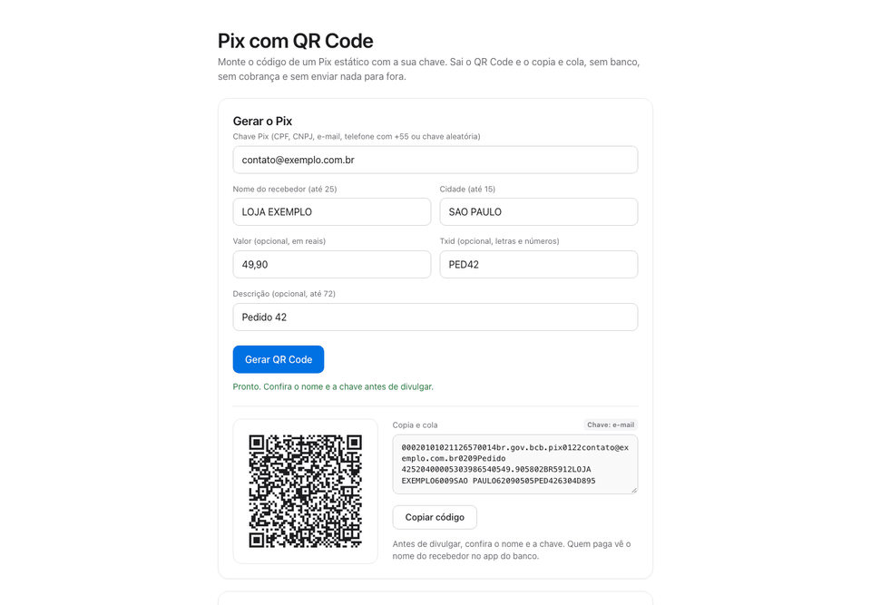

> **Este modelo mudou de casa.** Agora ele é a ferramenta `wortic pix` do projeto único
> [developer-wortic/ferramentas-rust](https://github.com/developer-wortic/ferramentas-rust) (pasta `crates/pix`), com o
> histórico deste repositório, um binário só para as quatro ferramentas e jsonW em tudo. Este repositório fica
> arquivado, só para leitura.
>
> *This template moved to [developer-wortic/ferramentas-rust](https://github.com/developer-wortic/ferramentas-rust)
> (`wortic pix`). This repository is archived.*

# Pix estático em Rust: BR Code, QR Code e leitura do copia e cola

<!-- GIF -->


Digite a chave Pix, o nome e a cidade, e saia com o QR Code e o copia e cola. Cole um código Pix e veja os campos. Tudo roda no seu computador, sem banco, sem cobrança e sem webhook.

[](LICENSE)

[](https://github.com/developer-wortic/modelo-pix-brcode-rust/actions/workflows/ci.yml)

**[Ver planos da Wortic](https://wortic.com.br/planos)**

## Três coisas que você pode conferir

1. **Os testes passam.** Rode `cargo test`. A cobertura de linhas é de 100% (1405 de 1405), medida com `cargo llvm-cov`.
2. **O CRC está certo.** O CRC16 do BR Code é o CRC16-CCITT-FALSE. O vetor de conferência `"123456789"` dá `0x29B1`, e o teste verifica isso.
3. **A tela funciona sem nada além do binário.** `cargo run --release` e abra http://127.0.0.1:8080.

## Início rápido

```sh
git clone https://github.com/developer-wortic/modelo-pix-brcode-rust
cd modelo-pix-brcode-rust
cargo run --release
```

Abra http://127.0.0.1:8080, digite uma chave (por exemplo `contato@exemplo.com.br`), o nome `LOJA EXEMPLO` e a cidade `SAO PAULO`, e clique em **Gerar QR Code**. Não precisa de cadastro nem de chave.

## O que vem pronto

- **Montar o BR Code estático.** Chave, valor opcional, nome e cidade do recebedor, txid e descrição. O CRC16 vai no campo 63.
- **Ler um BR Code.** Confere o CRC, separa os campos e devolve a chave, o valor, o nome, a cidade, o txid e a descrição. Recusa código com CRC errado, campo faltando, GUI diferente de `br.gov.bcb.pix`, moeda diferente de 986 e código dinâmico com URL.
- **Validar chaves.** CPF e CNPJ com dígito verificador, inclusive o CNPJ alfanumérico (letras nas 12 primeiras posições). E-mail, telefone com `+55` e chave aleatória (UUID versão 4). Tudo offline.
- **Texto sem acento.** Nome e cidade saem em ASCII (`Açaí` vira `Acai`). Campo que passa do limite dá erro, não corta em silêncio.
- **QR Code em SVG.** O codificador é a crate `qrcodegen` (Rust puro, MIT), sem C.
- **Um binário só.** A tela vai embutida no executável (`static/index.html`), sem build de front-end.

## Como usar a biblioteca

```rust
use pix_brcode::{Cobranca, leitura};

let codigo = Cobranca::nova("contato@exemplo.com.br", "LOJA EXEMPLO", "SAO PAULO")?
    .com_valor("49,90")?
    .com_txid("PED42")?
    .com_descricao("Pedido 42")?
    .codigo()?;

let lido = leitura::ler(&codigo)?;
assert_eq!(lido.valor.as_deref(), Some("49.90"));
```

O `codigo()` devolve o texto do copia e cola. Para o QR, passe o mesmo texto a `pix_brcode::qr::svg`.

## Rotas do seu backend

| Rota | O que faz |
|---|---|
| `GET /` | A tela |
| `GET /api/config` | Diz só se há `WORTIC_API_KEY` (`true` ou `false`). A chave nunca sai |
| `GET /api/gerar?chave=&nome=&cidade=&valor=&txid=&descricao=` | Devolve `codigo`, `qr_svg` e `tipo_chave` |
| `GET /api/ler?codigo=` | Devolve os campos do copia e cola |

Dado inválido volta com status 400, e rota que não existe volta com 404. Os dois vêm em JSON, como `{"erro":{"mensagem":"..."}}`, com a mensagem em português.

## Ajustes

| Variável | Para quê | Padrão |
|---|---|---|
| `PORTA` | Porta do servidor | `8080` |
| `ENDERECO` | Endereço de escuta. Com `0.0.0.0`, outras máquinas acessam | `127.0.0.1` |
| `WORTIC_API_KEY` | Liga os avisos das funções pagas (veja abaixo) | sem chave |

## O que é pago e não está aqui

Estas funções não fazem parte deste modelo. Na tela, cada uma tem o aviso e o link para os planos. Com `WORTIC_API_KEY`, a tela avisa que a rota correspondente ainda não existe na API pública da Wortic, então nada é chamado.

| Função | Por que não é aqui |
|---|---|
| Confirmar pagamento automaticamente | Precisa receber o aviso do banco ou do provedor |
| Pix dinâmico com vencimento | Precisa de um provedor de Pix que gere a cobrança |
| Conciliação | Precisa do extrato e dos pedidos |
| Checkout completo | Página de pagamento, cartão e controle de pedidos |

Quem quiser essas funções usa a Wortic: [wortic.com.br/planos](https://wortic.com.br/planos).

## Limites desta versão

- Só o Pix **estático**. Não há cobrança com vencimento, nem consulta a provedor, nem webhook.
- Os limites de tamanho seguem o que esta biblioteca usa: nome do recebedor até 25, cidade até 15, descrição até 72 e, juntas, chave e descrição até 99 caracteres (campo 26). Confira com o manual vigente do Banco Central antes de colocar em produção.
- O exemplo oficial do Manual de Padrões para Iniciação do Pix (chave aleatória, "Fulano de Tal", Brasília, CRC 1D3D) está nos testes (`tests/vetores.rs`): a leitura devolve os campos do manual e o CRC confere byte a byte.
- Não há banco nem cache. Cada pedido é independente.

## Onde mexer

- **Outro layout:** a tela é `static/index.html`, em HTML e CSS puros.
- **Outra regra de texto:** `src/texto.rs` (acentos, sinais aceitos e limites).
- **Outra chave ou outro formato:** `src/chave.rs`.

## Testes

```sh
cargo test
cargo clippy -- -D warnings -W clippy::pedantic
cargo fmt --check
```

Cobertura de linhas: 100% (1405 de 1405), medida com `cargo llvm-cov`. Os testes incluem os vetores de CRC, ida e volta para centenas de casos gerados, chaves válidas e inválidas, limites de tamanho, acentos, valor com centavos, e as rotas HTTP com o binário de verdade.

Cada push e cada pull request roda formatação, clippy (com o nível pedantic) e os testes no GitHub Actions. O arquivo está em `.github/workflows/ci.yml`.

## Privacidade

- O modelo não grava nada em disco e não manda nada para fora. A tela fala só com o servidor que você rodou.
- A chave, o nome e o valor que você digita ficam só na memória do pedido.
- Não há cookie, não há rastreio e não há chamada a terceiros.

## Perguntas frequentes

**Isso recebe o dinheiro?**
O dinheiro vai direto para a conta da chave, pelo app de quem paga. O modelo só monta o código.

**Precisa de conta na Wortic?**
Não. O modelo funciona sem conta e sem chave.

**Dá para confirmar que o cliente pagou?**
Não neste modelo. Confirmação automática é uma das funções pagas da Wortic.

**Aceita CNPJ alfanumérico?**
Sim. A conferência segue a regra nova, com letras nas 12 primeiras posições.

**Posso usar em produção?**
Confira os limites em "Limites desta versão" e teste com o seu banco antes. O código é de uso livre com créditos (licença AAL), então a decisão e a responsabilidade são suas.

**Posso usar no meu sistema comercial?**
Sim. O código é de uso livre com créditos (licença AAL): use, mude e venda o sistema feito a partir dele, mostrando "Feito com tecnologia Wortic".

## Contribuir e segurança

Veja [CONTRIBUTING.md](CONTRIBUTING.md) para contribuir e [SECURITY.md](SECURITY.md) para relatar falha de segurança.

## English

**Static Pix in Rust.** A small library and a ready-to-run form that build the Brazilian Pix static BR Code (EMV QRCPS-MPM), with the CRC16-CCITT-FALSE check, read a pasted copy-and-paste code back into its fields, validate Pix keys offline (CPF, CNPJ including the 2026 alphanumeric one, e-mail, +55 phone and random UUID v4 keys), and render the QR Code as SVG with the pure-Rust `qrcodegen` crate. No network, no database, no webhook. Dynamic Pix, payment confirmation, reconciliation and checkout are paid features of Wortic and are not included. Run `cargo run --release`, then open http://127.0.0.1:8080. Coverage is 100% of lines (1405 of 1405) with `cargo llvm-cov`. The official example from the Banco Central Pix manual is in the test suite and its CRC matches byte for byte. MIT licensed.

## Licença

Licença AAL, de uso livre com créditos: use, mude e venda o seu sistema feito a partir deste modelo, mostrando "Feito com tecnologia Wortic (wortic.com.br)". Texto completo em [LICENSE](LICENSE).

---

**[Ver planos da Wortic](https://wortic.com.br/planos)**
